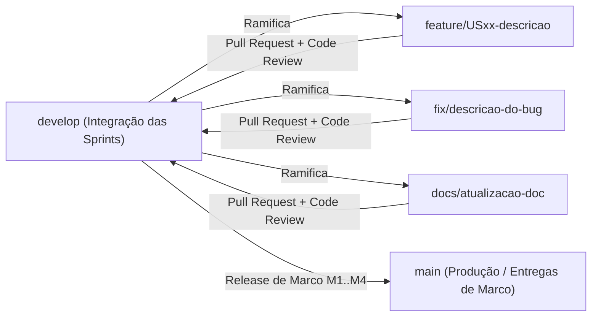

# 🤝 Guia de Contribuição e Engenharia Colaborativa (`CONTRIBUTING.md`)

Bem-vindo(a) ao repositório do **Projeto 11 — Sistema de Gestão de Vagas e Adaptação de Transporte Escolar Inclusivo**. Este documento define o fluxo de versionamento (**GitFlow**), padrões de nomenclatura de branches, convenção de commits, abertura de Pull Requests e critérios de Code Review adotados pela equipe.

---

## 👥 1. Equipe e Responsabilidades

| Área | Integrantes | Escopo de Revisão (Code Owners) |
| :--- | :--- | :--- |
| **Frontend** | Eduardo, Erick | `/frontend`, UI/UX, Acessibilidade, Design System e Integração de Mapas |
| **Backend** | Rita, Erick | `/backend`, API REST (Django/DRF), Regras de Negócio e Roteirização |
| **Banco de Dados & Modelagem** | Edmilson, Karina, Eduardo | `/docs`, Models, Migrations, PostGIS, Segurança e Conformidade LGPD |

---

## 🌿 2. Estratégia de Branches (GitFlow Adaptado)

Utilizamos o fluxo **GitFlow** estruturado em duas branches permanentes e branches temporárias de trabalho:



### Branches Permanentes
- **`main`**: Código estável e validado para as entregas oficiais dos Marcos (**M1, M2, M3 e M4**). Nenhum commit direto é permitido após o setup inicial.
- **`develop`**: Branch principal de integração contínua da equipe durante as Sprints.

### Branches de Trabalho (Temporárias)
Sempre crie sua branch a partir da `develop` atualizada:

| Prefixo | Quando usar | Exemplo |
| :--- | :--- | :--- |
| `feature/` | Nova funcionalidade ou História de Usuário | `feature/US01-checkin-monitor` |
| `fix/` | Correção de defeito ou bug identificado | `fix/validacao-capacidade-cadeirante` |
| `docs/` | Criação ou atualização de documentação/ADRs | `docs/adr-arquitetura-c4` |
| `chore/` | Configuração de ambiente, dependências, CI/CD | `chore/setup-nextjs-tailwind` |

---

## 📝 3. Padrão de Commits (Conventional Commits)

Adotamos o padrão **[Conventional Commits](https://www.conventionalcommits.org/pt-br/v1.0.0/)** para manter o histórico legível e auditável:

```text
<tipo>(<escopo opcional>): <descrição curta no imperativo>
```

### Tipos permitidos:
- `feat`: Nova funcionalidade (ex: `feat(trips): adicionar endpoint de check-in de embarque`)
- `fix`: Correção de bug (ex: `fix(fleet): corrigir validação de capacidade para cadeiras de rodas`)
- `docs`: Alterações apenas em documentação (ex: `docs(adr): adicionar diagrama C4 de contêineres`)
- `style`: Formatação, Tailwind/CSS ou lint sem mudança de lógica (ex: `style(ui): ajustar contraste dos botões do monitor`)
- `refactor`: Refatoração de código sem alterar comportamento externo
- `test`: Adição ou correção de testes automatizados
- `chore`: Atualização de pacotes, configurações de build ou scripts

---

## 🔄 4. Passo a Passo para Contribuir

1. **Sincronize sua branch `develop` local:**
   ```bash
   git checkout develop
   git pull origin develop
   ```
2. **Crie uma branch vinculada à História de Usuário ou tarefa do Kanban:**
   ```bash
   git checkout -b feature/US01-checkin-embarque
   ```
3. **Desenvolva e faça commits pequenos e semânticos:**
   ```bash
   git add .
   git commit -m "feat(monitor): implementar botão de check-in com confirmação"
   ```
4. **Envie sua branch para o repositório remoto:**
   ```bash
   git push -u origin feature/US01-checkin-embarque
   ```
5. **Abra um Pull Request (PR)** no GitHub apontando para a branch `develop` e preencha o template automático de PR.

---

## ✅ 5. Regras de Pull Request e Code Review (Definition of Done)

Para que uma tarefa seja movida para **Concluído (`Done`)** no Quadro Kanban:

1. O código deve estar em conformidade com os linters do projeto (**ESLint/Prettier** no Frontend; **Flake8/Black/Ruff** no Backend).
2. Nenhuma credencial, chave de API ou `.env` pode estar incluída no commit.
3. Regras críticas (como limite de vagas adaptadas e autorização de responsáveis) devem estar validadas no Backend.
4. Telas de Frontend devem respeitar as diretrizes de acessibilidade (**WCAG AA**, navegação por teclado e alvos de toque de no mínimo `48x48px` para o app do monitor/motorista).
5. O Pull Request deve ser revisado e aprovado por **pelo menos 1 outro integrante da equipe** antes do merge na `develop`.
