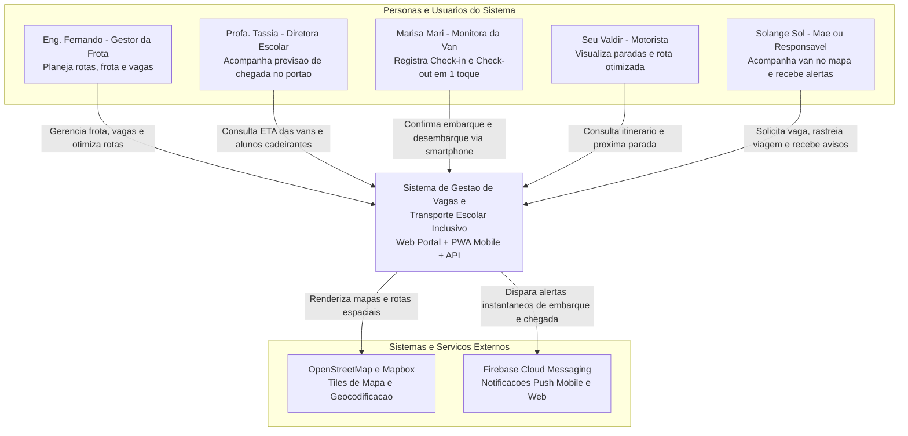
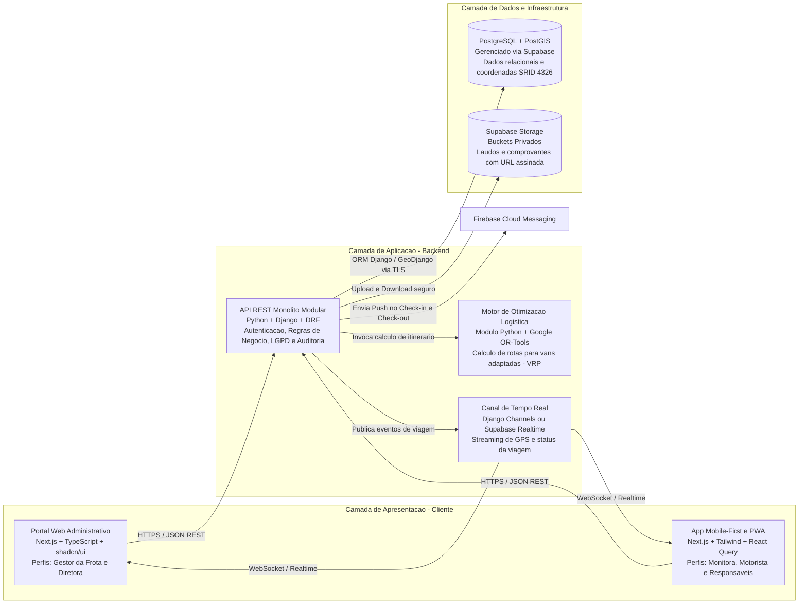
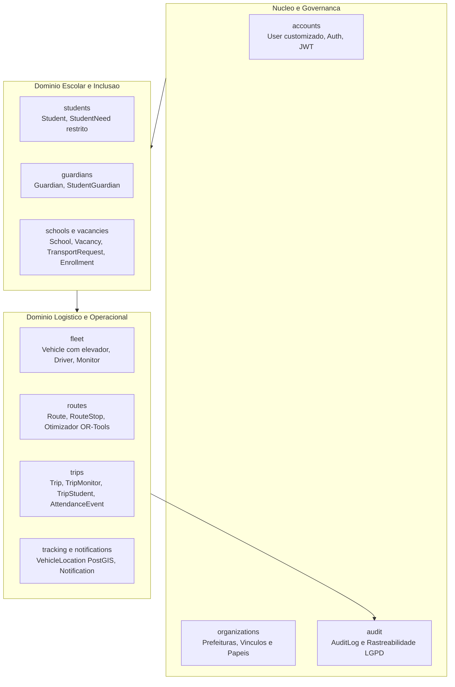
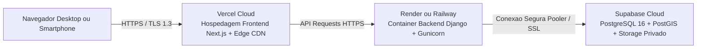

# 🏛️ Documento de Arquitetura e Decisões Tecnológicas (ADR)

**Projeto 11:** Sistema de Gestão de Vagas e Adaptação de Transporte Escolar Inclusivo  
**Entregável:** Marco 1 (M1 — Imersão no Problema, Planejamento da Arquitetura e Setup da Engenharia)  
**Versão:** 1.0 | **Data:** Novembro de 2026  
**Autores:** Eduardo Guerra, Erick, Rita, Edmilson e Karina

---

## 1. Visão Geral da Arquitetura

O sistema foi projetado para resolver o problema de evasão escolar e ineficiência logística no transporte escolar inclusivo (**LBI — Lei Brasileira de Inclusão, Art. 28 e 48**), conectando **5 atores principais** (Gestor da Frota, Motorista, Monitora da Van, Mãe/Responsável e Diretora Escolar) em uma arquitetura segura, responsiva e georreferenciada.

Para equilibrar **velocidade de entrega acadêmica/extensionista**, **rigor de regras de negócio** e **conformidade com a LGPD** (tratamento de dados pessoais de crianças e informações sensíveis de mobilidade/deficiência), adotamos uma arquitetura baseada em:

1. **Frontend Único Multi-Perfil (Web + PWA Mobile-First)** em **Next.js + TypeScript + Tailwind CSS + shadcn/ui**.
2. **Backend Monólito Modular** em **Python + Django + Django REST Framework (DRF)**, centralizando 100% das regras de negócio, autorização e auditoria.
3. **Persistência Relacional e Geoespacial** em **PostgreSQL + PostGIS** (gerenciado via **Supabase**).
4. **Serviços Especializados** para roteirização logística (**Google OR-Tools**), eventos em tempo real (**Supabase Realtime / Django Channels**) e notificações push (**Firebase Cloud Messaging**).

---

## 2. Diagramas de Arquitetura (Modelo C4 Simplificado)

### 2.1 C4 — Nível 1: Diagrama de Contexto do Sistema

Mostra como o sistema se relaciona com as **5 Personas** do projeto e com os serviços externos.

---

### 2.2 C4 — Nível 2: Diagrama de Contêineres

Detalha as aplicações, serviços e bancos de dados que compõem a solução e como se comunicam.

---

### 2.3 C4 — Nível 3: Organização Modular do Backend Django

Representa a divisão interna dos módulos de domínio (`apps/`) dentro do monólito modular Django:

---

### 2.4 Diagrama de Infraestrutura e Implantação (Cloud Target — Marco 4)

---

## 3. Registro de Decisões Arquiteturais (ADRs)

### ADR-001: Adoção de Monólito Modular com Python, Django e Django REST Framework

- **Status:** Aceito
- **Contexto:** O sistema possui regras de negócio fortemente acopladas e transacionais (alocação de vagas adaptadas, verificação de capacidade de cadeiras de rodas, validação de vínculo ativo `Enrollment` e restrição de acesso a dados sensíveis de crianças sob a LGPD). Além disso, o backend contará com integração geoespacial e algoritmos de otimização em Python.
- **Decisão:** Construir o backend como um **Monólito Modular** utilizando **Python + Django + Django REST Framework (DRF)**, separado em apps por domínio (`accounts`, `organizations`, `students`, `guardians`, `schools`, `vacancies`, `fleet`, `routes`, `trips`, `tracking`, `notifications`, `audit`).
- **Justificativa:**
  - Evita a complexidade operacional de microsserviços para uma equipe enxuta em cronograma de 4 meses.
  - O ORM do Django (com **GeoDjango**) oferece suporte nativo a transações ACID, migrations seguras e consultas espaciais no PostGIS.
  - O ecossistema Python permite integrar diretamente o **Google OR-Tools** para roteirização de veículos (VRP) no mesmo ambiente.
- **Consequências:**
  - *Positivas:* Alta velocidade de desenvolvimento, segurança centralizada e facilidade de manutenção por Rita e Erick.
  - *Negativas/Mitigação:* Exige disciplina para manter fronteiras claras entre os `apps/` e não criar dependências circulares.

---

### ADR-002: Adoção de Next.js (App Router), TypeScript, Tailwind CSS e shadcn/ui no Frontend

- **Status:** Aceito
- **Contexto:** O sistema precisa atender perfis com necessidades visuais e dispositivos completamente distintos:
  1. **Desktop analítico** para o Gestor da Frota (Fernando) e a Diretora (Tássia);
  2. **Mobile em campo** para a Monitora (Marisa — check-in com 1 toque ao lado da rampa elevatória), o Motorista (Seu Valdir — letramento digital básico, botões grandes e alto contraste) e a Mãe (Solange — acompanhamento ansioso pelo celular).
- **Decisão:** Utilizar **Next.js (React + TypeScript)** com **Tailwind CSS**, componentes acessíveis **shadcn/ui (Radix UI)**, **TanStack Query** e **React Hook Form + Zod**, entregando tanto o portal web quanto uma experiência **PWA Mobile-First**.
- **Justificativa:**
  - **Uma única base de código (`codebase`)** gerenciada por Eduardo e Erick atende desktop e mobile sem precisar manter um app nativo separado em paralelo.
  - O **shadcn/ui** garante conformidade com padrões de acessibilidade (**WAI-ARIA**, navegação por teclado e contraste), coerente com a proposta de um sistema voltado à inclusão.
  - O **TypeScript + Zod** previne erros de contrato de dados no cadastro de necessidades especiais e coordenadas geográficas.
- **Consequências:**
  - *Positivas:* Padronização visual, excelente performance e facilidade de publicação na Vercel.
  - *Negativas/Mitigação:* Componentes de mapa (`Leaflet`) exigem renderização no cliente (`"use client"` / `dynamic import` sem SSR no Next.js).

---

### ADR-003: PostgreSQL Gerenciado (Supabase) com Extensão PostGIS

- **Status:** Aceito
- **Contexto:** O projeto exige integridade relacional rigorosa (chaves únicas compostas, histórico auditável de embarque/desembarque) combinada com armazenamento e consulta de coordenadas geográficas (endereços de alunos, escolas, paradas `RouteStop` e telemetria `VehicleLocation`).
- **Decisão:** Utilizar **PostgreSQL** gerenciado pelo **Supabase** com a extensão **PostGIS** habilitada (`SRID 4326`), mantendo o **Django como única porta de entrada** para regras de negócio.
- **Justificativa:**
  - O PostgreSQL + PostGIS é o padrão ouro de mercado para sistemas de informação geográfica (GIS) e logística.
  - O Supabase fornece infraestrutura gerenciada gratuita/acessível para o projeto extensionista, com backups e painel de inspeção para a equipe de banco de dados (Edmilson, Karina e Eduardo).
  - Centralizar o acesso via API Django evita espalhar regras de negócio no frontend e protege chaves administrativas.
- **Consequências:**
  - *Positivas:* Suporte a índices espaciais, cálculo de distância real e constraints relacionais fortes.
  - *Negativas/Mitigação:* Volume alto na tabela `VehicleLocation` exige política de retenção e índices em `(trip_id, recorded_at)`.

---

### ADR-004: Privacidade, Segurança por Design e Conformidade com a LGPD

- **Status:** Aceito
- **Contexto:** O sistema manipula dados pessoais de crianças e adolescentes (Art. 14 da LGPD) e dados pessoais sensíveis referentes à saúde/deficiência (`StudentNeed`: tipo de cadeira de rodas, tetraplegia, necessidade de acompanhante) e localização em tempo real.
- **Decisão:** Implementar controle de acesso baseado em papéis e organização (**RBAC Multi-Tenant via `OrganizationMembership`**), segregação da entidade `StudentNeed`, chaves primárias em `UUID v4` e trilha de auditoria em `AuditLog`.
- **Justificativa:**
  - Impede enumeração sequencial de IDs de alunos em URLs (`UUID`).
  - Garante que uma mãe (`Guardian`) veja exclusivamente os eventos e a localização da viagem em que seu filho está alocado e autorizado (`StudentGuardian.can_receive_notifications = True`).
  - Restringe `mobility_notes` apenas à equipe operacional autorizada.
- **Consequências:**
  - *Positivas:* Conformidade jurídica e ética com a proteção de menores e pessoas com deficiência.
  - *Negativas/Mitigação:* Todos os endpoints do DRF devem aplicar `QuerySet` filtrado por `organization_id` e perfil do usuário autenticado.

---

### ADR-005: Visualização Geográfica com Leaflet / OpenStreetMap e Otimização com OR-Tools

- **Status:** Aceito
- **Contexto:** A História de Usuário `US02` exige o cálculo da rota mais rápida considerando alunos cadeirantes e a exibição do itinerário no mapa com estimativa de chegada (ETA).
- **Decisão:** Utilizar **`react-leaflet` + OpenStreetMap** no Frontend para renderização de mapas sem custo de cartão de crédito/licença, e **Google OR-Tools** (combinado a matriz de distância/OSRM) no Backend para ordenação das paradas (`RouteStop.sequence`).
- **Justificativa:**
  - Evita bloqueios por limites financeiros de APIs proprietárias durante a validação acadêmica, mantendo a arquitetura aberta para plugar Mapbox ou Google Maps API caso a prefeitura parceira possua licença.
