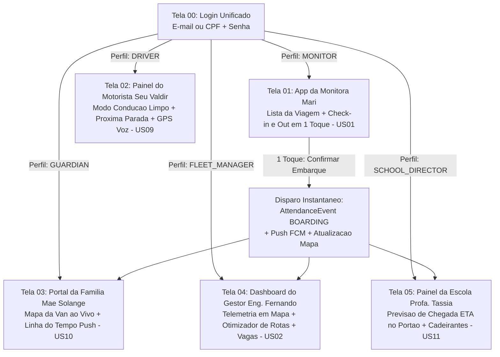

# 🖼️ Protótipo de Baixa/Média Fidelidade (Wireframes e Fluxos de Tela)

**Projeto 11:** Sistema de Gestão de Vagas e Adaptação de Transporte Escolar Inclusivo  
**Entregável:** Marco 1 (M1 — Protótipo de Baixa/Média Fidelidade baseado nas Personas e Cenários de Uso)  
**Responsáveis UI/UX & Frontend:** Eduardo Guerra e Erick  
**Arquivo Oficial no Figma (5 Telas Editáveis):** [🎨 Abrir Protótipo no Figma — Projeto 11 (Marco 1)](https://www.figma.com/design/caIccM5BeNfomthMS7QNVl)

---

## 1. Mapa Geral de Navegação por Persona

O sistema adapta sua estrutura de navegação e densidade de informação ao contexto físico e ao letramento digital de cada uma das **5 Personas** definidas no PRD:



---

## 2. Wireframes Detalhados por Persona e Cenário de Uso

---

### 🦺 Persona 1: Marisa "Mari" da Silva — App Móvel da Monitora (`US01`)

- **Contexto de Uso:** Em pé na calçada ao lado da van, operando a rampa elevatória hidráulica e travando o cinto de 5 pontos da cadeira de rodas. Precisa confirmar o embarque com **apenas 1 toque** usando uma mão.
- **Diretrizes de UI:** Mobile-First (`360x800`), alto contraste (WCAG AAA sob sol), botões de `56px` de altura, trava de segurança que impede encerrar a viagem se restar algum aluno embarcado sem check-out.

```text
+-------------------------------------------------------+
| 🚌 VAN 04 - ROTA MANHÃ SETOR NORTE       🟢 EM VIAGEM |
| Motorista: Valdir  |  Destino: E.M. Inclusiva Aurora  |
+-------------------------------------------------------+
| Progresso de Embarque: [████████░░░░] 2 de 3 a bordo  |
| ♿ Vagas Cadeira de Rodas: 2 / 3 ocupadas              |
+-------------------------------------------------------+
| 🔍 [ Buscar aluno na viagem... ]        [ 📷 Ler QR ] |
+-------------------------------------------------------+
|                                                       |
| +---------------------------------------------------+ |
| | 📍 PARADA ATUAL (2/4) — Rua das Flores, 123       | |
| |                                                   | |
| | 👦 MATEUS APARECIDO (8 anos)                      | |
| | [♿ Cadeira Motorizada] [🤝 Auxílio Rampa]         | |
| | Resp: Solange ("Sol") • (11) 99876-5432           | |
| |                                                   | |
| | +-----------------------------------------------+ | |
| | |   ✅ CONFIRMAR EMBARQUE (1 TOQUE)             | | |
| | |      (Envia alerta imediato para a mãe)       | | |
| | +-----------------------------------------------+ | |
| +---------------------------------------------------+ |
|                                                       |
| +---------------------------------------------------+ |
| | 📍 PARADA 1/4 — Av. Brasil, 450      [EMBARCADO]  | |
| | 👧 LUCAS SILVA (10 anos)                          | |
| | [♿ Cadeira Manual] • Embarcou às 07:05h          | |
| | [ 🔽 Registrar Desembarque na Escola ]            | |
| +---------------------------------------------------+ |
|                                                       |
| +---------------------------------------------------+ |
| | 📍 PARADA 3/4 — Rua Ipê, 88          [AGUARDANDO] | |
| | 👧 SOFIA MENDES (9 anos)                          | |
| | [♿ Cadeira Manual] [👤 Com Acompanhante]         | |
| +---------------------------------------------------+ |
|                                                       |
+-------------------------------------------------------+
| [ 📋 Lista de Alunos ]  [ 🗺️ Rota ]  [ ⚠️ Ocorrência ]|
+-------------------------------------------------------+
```

---

### 🚐 Persona 2: Seu Valdir "Valdivino" Rangel — Modo Condução do Motorista (`US09`)

- **Contexto de Uso:** Smartphone fixado no suporte do painel da van. Letramento digital básico (acostumado com WhatsApp e Waze). Não pode ter textos pequenos nem distrações enquanto dirige.
- **Diretrizes de UI:** Tipografia gigante (`20px–28px`), zero menus ocultos, indicação clara se a próxima parada exige acionamento do elevador hidráulico e botão direto de voz/GPS.

```text
+-------------------------------------------------------+
| 🚐 VAN 04 • ROTA OTIMIZADA               🕒 07:10h    |
| Destino Final: Escola Municipal Inclusiva Aurora      |
+-------------------------------------------------------+
|                                                       |
|   PRÓXIMA PARADA (PARADA 2 DE 4) — A 400 METROS       |
| +---------------------------------------------------+ |
| |                                                   | |
| |  🏠 RUA DAS FLORES, Nº 123                        | |
| |     Bairro Jardim Esperança                       | |
| |                                                   | |
| |  👦 Aluno: MATEUS APARECIDO                       | |
| |                                                   | |
| |  +---------------------------------------------+  | |
| |  | ♿ ATENÇÃO: PREPARAR ELEVADOR HIDRÁULICO    |  | |
| |  +---------------------------------------------+  | |
| +---------------------------------------------------+ |
|                                                       |
| +---------------------------------------------------+ |
| |  🔊  ABRIR NAVEGAÇÃO GPS POR VOZ (WAZE / MAPS)    | |
| +---------------------------------------------------+ |
|                                                       |
| +---------------------------------------------------+ |
| |  ⏭️  CHEGUEI NO LOCAL / AVANÇAR PRÓXIMA PARADA    | |
| +---------------------------------------------------+ |
|                                                       |
| Próxima depois desta: Rua Ipê, 88 (Aluna Sofia - 07:22)|
+-------------------------------------------------------+
```

---

### 👩‍👦 Persona 3: Solange "Sol" Aparecida — App/Portal da Família (`US10`)

- **Contexto de Uso:** Mãe ansiosa de aluno de 8 anos com tetraplegia. Acompanha pelo celular o momento exato em que o filho entra na van e o deslocamento até o portão da escola.
- **Diretrizes de UI:** Banner de status tranquilizador no topo, mapa ao vivo da Van 04 e linha do tempo auditável com horários exatos de check-in e check-out.

```text
+-------------------------------------------------------+
| 💙 Olá, Solange!                     🔔 [2 Avisos]    |
| Transporte de: MATEUS APARECIDO (Van 04 - Adaptada)   |
+-------------------------------------------------------+
| +---------------------------------------------------+ |
| | 🟢 STATUS ATUAL: MATEUS ESTÁ A BORDO DA VAN 04    | |
| |    Previsão de chegada na escola: 07:35h (12 min) | |
| +---------------------------------------------------+ |
|                                                       |
| +---------------------------------------------------+ |
| | 🗺️ MAPA EM TEMPO REAL (Leaflet / PostGIS)         | |
| |                                                   | |
| |    [🏠 Casa] ------> [🚌 Van 04 (38 km/h)]        | |
| |                              \                    | |
| |                               +---> [🏫 Escola]   | |
| |                                                   | |
| |  Monitora a bordo: Marisa ("Mari")                | |
| |  Motorista: Seu Valdir • Placa: ABC-1D23          | |
| +---------------------------------------------------+ |
|                                                       |
| 📋 LINHA DO TEMPO DE HOJE (26/11):                    |
|  ● 07:00h — Viagem iniciada pela Van 04               |
|  ● 07:12h — ✅ Mateus embarcou com segurança          |
|             (Confirmado pela monitora Marisa)         |
|  ○ ~07:35h — Desembarque previsto na E.M. Aurora      |
|                                                       |
+-------------------------------------------------------+
| [ 📍 Viagem Agora ]  [ 📅 Solicitar/Vaga ]  [ 📞 Apoio]|
+-------------------------------------------------------+
```

---

### 👨‍💼 Persona 4: Eng. Fernando "Nando" Prado — Dashboard do Gestor da Frota (`US02` & `US12`)

- **Contexto de Uso:** Engenheiro de Tráfego na prefeitura utilizando monitor desktop widescreen. Analisa indicadores de quilometragem, gerencia solicitações de vagas adaptadas e executa o algoritmo otimizador de rotas (`OR-Tools`).
- **Diretrizes de UI:** Layout Desktop com Sidebar, cards de KPIs estratégicos, painel dividido entre lista de rotas/solicitações e mapa GIS com toda a frota municipal.

```text
+--------------------------------------------------------------------------------------------------+
| 🏛️ PREFEITURA MUNICIPAL — GESTÃO DE TRANSPORTE ESCOLAR INCLUSIVO      👤 Eng. Fernando  [Sair]  |
+------------------+-------------------------------------------------------------------------------+
| MENU LATERAL     | 📊 INDICADORES OPERACIONAIS DO DIA                                            |
|                  | +-----------------+ +------------------+ +-----------------+ +--------------+ |
| ▸ [📊 Dashboard] | | 🚌 Vans Ativas  | | ♿ Alunos a Bordo| | ⏱️ Tempo Médio  | | ⛽ Economia  | |
| ▸ [🗺️ Rotas/VRP] | |    12 / 14      | |   86 Cadeirantes | |  31 min (-18%)  | | -18% km/dia  | |
| ▸ [🎟️ Vagas]     | +-----------------+ +------------------+ +-----------------+ +--------------+ |
| ▸ [👦 Alunos]    |                                                                               |
| ▸ [🚐 Frota]     | +-----------------------------------+ +-------------------------------------+ |
| ▸ [🏫 Escolas]   | | 🧮 OTIMIZADOR DE ROTAS (US02)     | | 🗺️ MAPA DE TELEMETRIA DA FROTA      | |
| ▸ [🛡️ Auditoria] | | Rota: Setor Norte -> E.M. Aurora  | |                                     | |
|                  | | Veículo: Van 04 (Elevador: SIM)   | |   [🚌 Van 01]       [🏫 E.M. Aurora]| |
|                  | | Ocupação Cadeira: 3/3 | Comum: 4/8| |         \              ^            | |
|                  | |                                   | |          +===[🚌 Van 04] (07:35 ETA)| |
|                  | | Paradas Ordenadas (OR-Tools):     | |          |                          | |
|                  | | 1. 07:05 - Lucas (Av. Brasil, 450)| |       [📍P2 Mateus]                 | |
|                  | | 2. 07:12 - Mateus (R. Flores, 123)| |          |                          | |
|                  | | 3. 07:22 - Sofia (R. Ipê, 88)     | |       [📍P1 Lucas]                  | |
|                  | | 4. 07:35 - 🏫 E.M. Aurora (Chegada| |                                     | |
|                  | |                                   | | Legenda: 🟢 No horário  🟠 Atenção  | |
|                  | | [ ⚡ Recalcular Rota Otimizada ]  | +-------------------------------------+ |
|                  | +-----------------------------------+                                         |
|                  |                                                                               |
|                  | 📥 SOLICITAÇÕES DE VAGA PENDENTES (TransportRequest -> Enrollment)            |
|                  | • Pedro Henrique (Cadeira Motorizada) -> E.M. Aurora [ ✅ Aprovar Vaga ]      |
+------------------+-------------------------------------------------------------------------------+
```

---

### 👩‍🏫 Persona 5: Profa. Tássia Camargo — Portal da Escola Receptora (`US11`)

- **Contexto de Uso:** Diretora checando o computador da secretaria ou tablet no portão principal às 07:30h da manhã para posicionar os estagiários e monitores internos antes das vans estacionarem.
- **Diretrizes de UI:** Painel estilo "Quadro de Chegadas", destacando as vans a menos de 5 minutos do portão e a quantidade exata de estudantes cadeirantes que precisam de recepção assistida.

```text
+--------------------------------------------------------------------------------------------------+
| 🏫 ESCOLA MUNICIPAL INCLUSIVA AURORA — PAINEL DE RECEPÇÃO NO PORTÃO   👩‍🏫 Profa. Tássia | 07:30h |
+--------------------------------------------------------------------------------------------------+
| Resumo do Turno Manhã: 4 Vans esperadas | 11 Alunos com Cadeira de Rodas | 3 Vans em deslocamento|
+--------------------------------------------------------------------------------------------------+
| ⚠️ ALERTA DE PORTÃO: A VAN 04 CHEGARÁ EM 5 MINUTOS (3 ALUNOS CADEIRANTES A BORDO)                |
+--------------------------------------------------------------------------------------------------+
| VEÍCULO / ROTA        | MOTORISTA / MONITORA | ALUNOS A BORDO (ACESSIBILIDADE) | ETA / STATUS    |
+-----------------------+----------------------+---------------------------------+-----------------+
| 🚌 VAN 04             | Mot: Seu Valdir      | Total: 3 alunos                 | 🟠 CHEGA EM     |
| Rota Setor Norte      | Mon: Marisa ("Mari") | • 1 Cadeira Motorizada (Mateus) |    5 MINUTOS    |
| [Elevador Hidráulico] |                      | • 2 Cadeiras Manuais (Lucas,    |    (07:35h)     |
|                       |                      |   Sofia + 1 Acompanhante)       | [Posicionar Eq.]|
+-----------------------+----------------------+---------------------------------+-----------------+
| 🚌 VAN 02             | Mot: Carlos Eduardo  | Total: 4 alunos                 | ✅ DESEMBARCADO |
| Rota Centro-Sul       | Mon: Juliana         | • 2 Cadeiras Manuais            |    ÀS 07:24h    |
+-----------------------+----------------------+---------------------------------+-----------------+
| 🚌 VAN 07             | Mot: Roberto         | Total: 4 alunos                 | 🟢 EM ROTA      |
| Rota Leste            | Mon: Patrícia        | • 4 Cadeiras Manuais            |    ETA: 07:45h  |
+-----------------------+----------------------+---------------------------------+-----------------+
```
